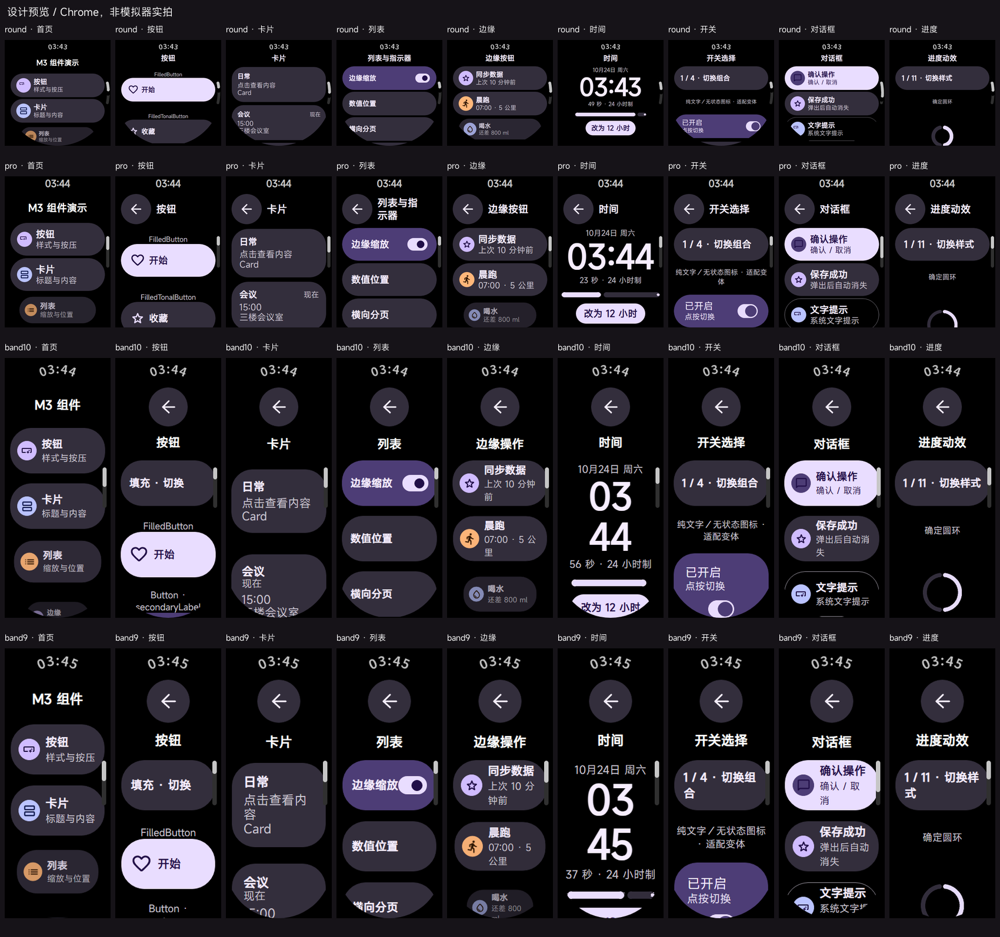

# vela-wear-m3

面向小米 Vela JS 快应用的 Wear Material 3 **生成式组件库**，以及使用该库的非商业 Demo。



支持 round（466×466）、Pro（336×480）、band10（212×520）、band9（192×490）；API 1 基础动画和 API 2 增强动画。组件库在构建时生成普通 UX、JavaScript 与局部图形资源，避免为每个控件增加自定义组件 ViewModel。

## 组件库与 Demo

| 内容 | 位置 | 授权 |
|---|---|---|
| 可独立安装的库、组件模板、令牌、状态逻辑和资源生成工具 | [packages/vela-wear-m3](packages/vela-wear-m3) | GPL-3.0-or-later，含指定 Demo 集成许可 |
| 九页 Gallery、演示数据、页面导航与展示素材 | `template/`、`docs/screenshots/` | PolyForm Noncommercial 1.0.0；具体第三方素材除外 |
| 无非商业限制的最小接入示例 | [库内 examples/minimal](packages/vela-wear-m3/examples/minimal) | GPL-3.0-or-later |

库覆盖 Button / IconButton / CompactButton、Card、Switch / Checkbox / Radio、InlineSlider、Stepper / LevelIndicator、分页、TimeText / Arc、ScrollIndicator / TLC、EdgeButton、Confirmation / AlertDialog、圆环 / 弧形 / 分段 / 线性进度。官方默认、可选变体和项目适配变体分别标注。接口说明与接入契约见[组件库文档](packages/vela-wear-m3/README.md)。

**组件库允许遵守 GPL 的免费或收费商用；Demo 不允许许可范围之外的商用。**GPL 用户无需强制向作者付费。需要闭源分发的，可洽谈作者有权授予的单独商业授权，见 [COMMERCIAL.md](COMMERCIAL.md)。Demo 属于源码可见的非商业软件，不将整个仓库统称为开源项目。

原创部分 Copyright © 2026 heDuke。AndroidX、Material Symbols、字体和参考图保留各自许可，详见 [LICENSE.md](LICENSE.md)、[第三方声明](THIRD_PARTY_NOTICES.md)与[官方 Demo 集成许可](packages/vela-wear-m3/DEMO-EXCEPTION.md)。本项目不隶属 Google 或小米，不授予其商标或设计的独占权。

## 本地运行 Demo

Node.js 18+，建议 Node.js 20。首次构建需要安装开发依赖：

```sh
npm ci
node tools/gen.js band10 --animation enhanced
npm run build:all
node tools/package-builds.js
```

`npm run build:all` 生成四设备 × 两种 API × debug/release 共 16 包。也可传设备名缩小构建范围：`npm run build:all -- band10 band9`。manifest 是 Demo 版本的真值；包名保留 `com.velam3.demo`。`src/`、`out/` 是生成物，不能手工维护。

日常生成使用随库提供的 PNG，不需要下载字体或运行图形生成工具。仅重新生成资源需要 Python + Pillow、Chrome 与可选字体输入；独立字形改用 OFL Noto Sans SC。SDK、模拟器和字体二进制不随仓库分发。

## 在自己的项目中使用库

```sh
npm pack ./packages/vela-wear-m3
# 在其他项目中安装得到的 vela-wear-m3-0.1.0.tgz
npm install -D ./vela-wear-m3-0.1.0.tgz
npx vela-wear-m3 gen --input template --out src --device round --animation basic
```

初次接入可复制库内 GPL 最小示例的 template，避免复制受非商业限制的 Gallery 页面。生成代码含库模板和逻辑，分发时仍需履行 GPL 或适用商业许可义务。库包不依赖本仓库 Demo 的路径、演示数据或构建环境。

## 验证与限制

```sh
npm run test:library
npm run verify
npm run preview
```

独立包测试覆盖 tarball 外部消费、四设备/两种 API、资源/许可完整性和输出目录保护。页面检查覆盖取消、反向切换、长按边界、分页、确认层竞态与计时器清理。CI 在 Linux 上运行源码和生成器检查；不宣称完成设备性能验证。

**当前完整 Demo 包体仍超预算，原生 30fps 与 API 2 动画验收尚未完成。**模拟器存在振动驱动重启、资源读取和镜像挂载问题。Chrome 预览、局部资源演示与原生诊断分开标记；Pro/band9 只有设计预览及构建检查。详情见 [UI 验收记录](docs/UI-ACCEPTANCE-2026-10-24.md)与[发布记录](docs/OPEN-SOURCE-RELEASE.md)。

没有将库重构视为性能目标已达成；没有不兼容机型的真机结论。原有交接与设计对照保存在 docs/，历史记录不是当前验收状态。

欢迎按 [CONTRIBUTING.md](CONTRIBUTING.md)提交贡献；授权问题请联系[仓库维护者](https://github.com/heDuke/vela-wear-m3/issues)。
