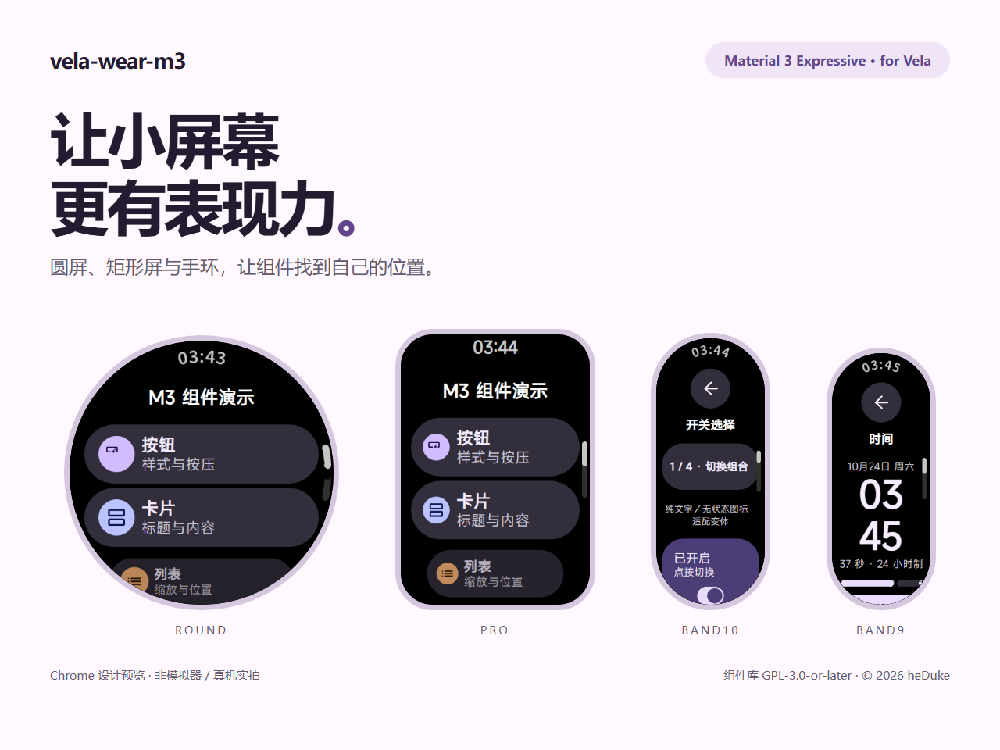
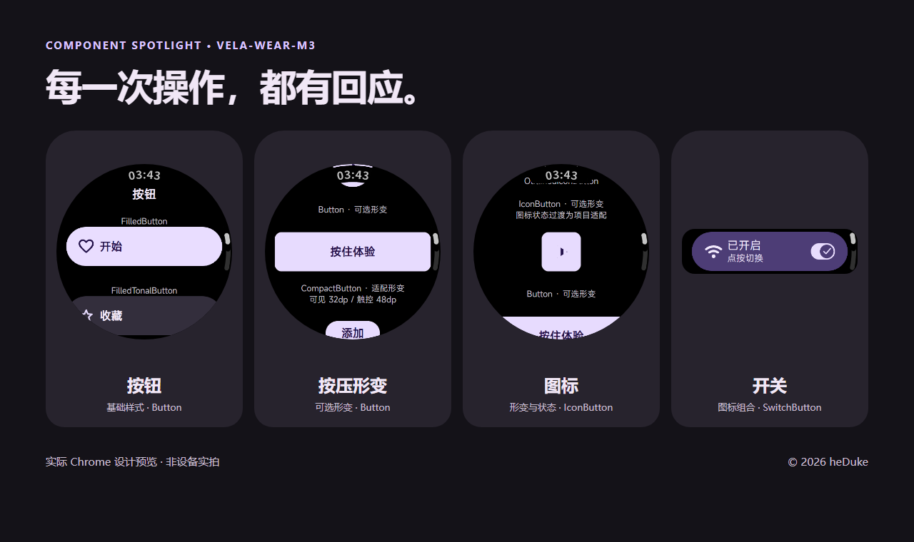
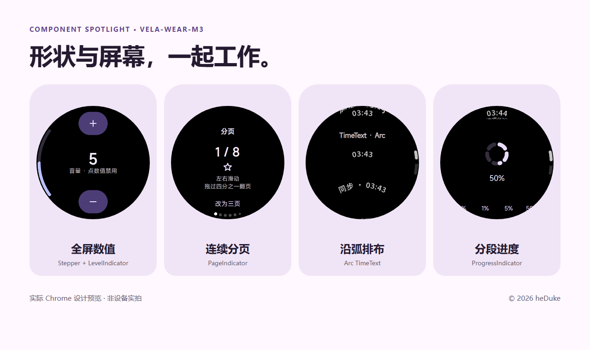
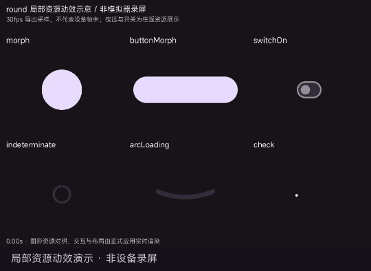
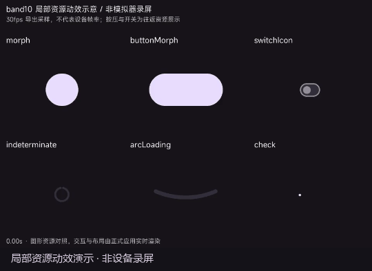

# vela-wear-m3

**面向小米 Vela 的 Wear Material 3 Expressive 组件库。**

为圆屏、矩形屏和手环提供组件、布局与交互动效；随附一个使用该库的九页 Demo。

[下载体验](https://github.com/heDuke/vela-wear-m3/releases/tag/v0.1.0) · [开始接入](packages/vela-wear-m3/docs/GETTING-STARTED.md) · [API 文档](packages/vela-wear-m3/docs/API.md) · [组件指南](packages/vela-wear-m3/docs/COMPONENTS.md)

<picture>
  <source media="(prefers-color-scheme: dark)" srcset="docs/promotion/bandbbs/cover-dark.png">
  <source media="(prefers-color-scheme: light)" srcset="docs/promotion/bandbbs/cover-light.png">
  
</picture>

## 让小屏幕更有表现力

圆润的按钮、随按压变化的形状、沿屏幕边缘排布的时间与指示器，让操作和反馈保持联系。实现参考固定版本的 AndroidX Wear Compose Material3，并针对 Vela 的渲染能力和窄屏空间做适配。





| 圆屏局部动效 | 手环局部动效 |
|---|---|
|  |  |

以上为 **Chrome 设计预览与局部资源动效演示，不是模拟器或真机录屏**。GIF 的采样速度也不代表设备帧率。[查看四布局九页画廊与关键帧](docs/screenshots/ui-2026-10-24/README.md)。

组件包括 Button、IconButton、CompactButton、Card、Switch、Checkbox、Radio、InlineSlider、Stepper、LevelIndicator、分页、TimeText、ScrollIndicator、列表变换、EdgeButton、进度、对话框与确认层。官方参考样式、可选变体和项目适配分别说明；CompactButton 额外形变等属于项目适配，不统称为官方默认效果。

## 按屏幕组织，而不是整页缩小

| 布局配置 | 画布 | 排布方式 |
|---|---|---|
| `round` | 466 × 466 | 圆屏阅读区域、Arc 时间、贴边组件；无页面返回按钮 |
| `pro` | 336 × 480 | 利用横向空间，顶部默认直排时间 |
| `band10` | 212 × 520 | 单列内容、顶部居中返回、独立一行的滑块轨道 |
| `band9` | 192 × 490 | 更窄的纵向排布；时间演示的小时与分钟上下排列 |

这些是**提供的布局配置，不是已验证兼容的机型清单**。当前四配置均完成生成与构建检查，最终原生运行与性能验收尚未完成。

| 动画配置 | 最低 API | 能力与边界 |
|---|---|---|
| `basic` | API 1 | 基础动画；连续形变、对勾描画和部分弧段变化降级 |
| `enhanced` | API 2 | 用局部帧资源补充形变与图标变化；设备运行待验证 |

## 下载或接入

**想体验 Demo**：到 [v0.1.0 实验性预发布](https://github.com/heDuke/vela-wear-m3/releases/tag/v0.1.0)选择对应布局 ZIP。每份包含 API 1／API 2 的 debug／release 包及说明；API 等级和构建模式分别选择，安装仍取决于固件和安装工具。`release` 表示构建模式，不代表稳定性认证。

**想开发自己的应用**：安装预发布中的独立库 tarball，从库内 GPL 最小示例开始。组件在构建时展开为普通 UX／JavaScript 和所需图片，不需要将 Gallery 页面复制进你的项目。尚未发布 npm registry。

- [从空目录到首个 debug 包](packages/vela-wear-m3/docs/GETTING-STARTED.md)
- [生成器与 CLI API](packages/vela-wear-m3/docs/API.md)
- [组件绑定、状态与生命周期](packages/vela-wear-m3/docs/COMPONENTS.md)

本地运行九页 Demo（Node.js 20 推荐，最低 18）：

```sh
git clone https://github.com/heDuke/vela-wear-m3.git
cd vela-wear-m3
npm ci
node tools/gen.js band10 --animation basic
npm run build
```

全矩阵构建用 `npm run build:all`，打包用 `node tools/package-builds.js`。`src/`、`out/` 为生成物；日常构建使用随库提供的图片，不需要重新生成资源或下载字体。

## 当前状态

独立库已验证四布局 × 两种 API 的生成、tarball 消费、资源和许可完整性；源码检查覆盖关键交互与计时器清理。具体记录见[发布说明](docs/OPEN-SOURCE-RELEASE.md)。

**原生性能、API 2 动画和真机兼容性仍待验证，完整 Demo 包体仍超预算**。这次发布用于交流与测试，不以设计预览推断设备流畅度。原生环境问题及差异见 [UI 验收记录](docs/UI-ACCEPTANCE-2026-10-24.md)。

## 许可与参与

| 内容 | 许可 |
|---|---|
| 独立组件库、生成器、库内最小示例 | GPL-3.0-or-later |
| 九页 Demo 及其原创展示素材 | PolyForm Noncommercial 1.0.0 |
| 第三方代码、图标、字体与参考资料 | 各自原许可 |

**组件库允许遵守 GPL 的免费或收费商用；Demo 限于其许可允许的非商业用途**。需要闭源分发时可洽谈单独商业授权，GPL 用户无需强制向作者付费。详见[授权范围](LICENSE.md)、[商业授权说明](COMMERCIAL.md)与[第三方声明](THIRD_PARTY_NOTICES.md)。

原创部分 © 2026 heDuke。本项目不隶属 Google 或小米。欢迎通过 [Issues](https://github.com/heDuke/vela-wear-m3/issues)交流，贡献前请阅读 [CONTRIBUTING.md](CONTRIBUTING.md)。
