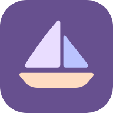
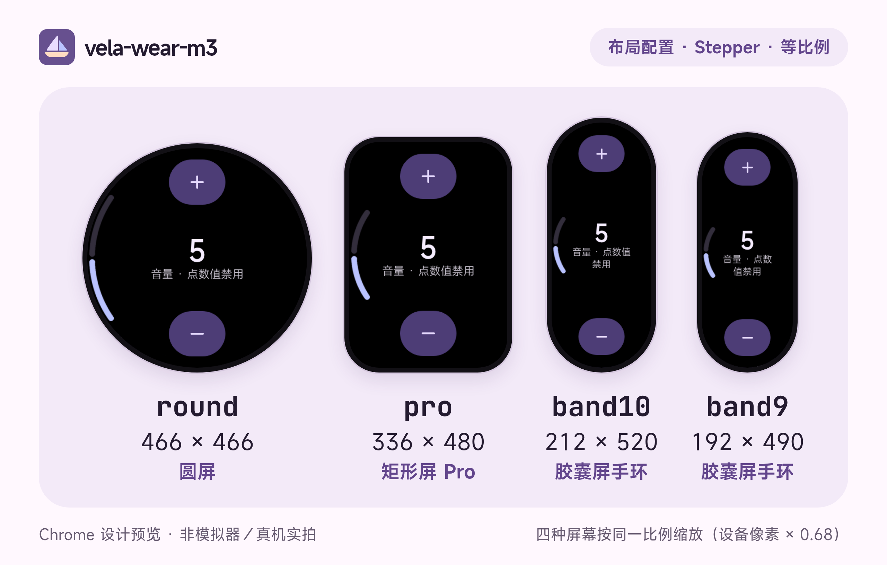

# vela-wear-m3



**面向小米 Vela 的 Wear Material 3 Expressive 组件库。**

为圆屏、矩形屏（Pro）和胶囊屏手环（band10／band9）提供组件、布局与交互动效，并随附一个使用该库的九页 Demo。

[下载预发布](https://github.com/heDuke/vela-wear-m3/releases/tag/v0.1.0) · [开始接入](packages/vela-wear-m3/docs/GETTING-STARTED.md) · [API 文档](packages/vela-wear-m3/docs/API.md) · [组件指南](packages/vela-wear-m3/docs/COMPONENTS.md) · [AI 开发工具使用声明](#ai-开发工具使用声明)

<picture>
  <source media="(prefers-color-scheme: dark)" srcset="docs/promotion/bandbbs/cover-dark.png">
  <source media="(prefers-color-scheme: light)" srcset="docs/promotion/bandbbs/cover-light.png">
  
</picture>

## 这是什么

- **编译期组件库**：组件在构建时展开为普通 UX／JavaScript 和所需图片，不需要把 Demo 页面复制进你的项目，也不是运行时 `<import>` 的自定义组件。
- **对照官方实现**：尺寸、配色、形状与动效参考固定提交的 [AndroidX Wear Compose Material3](https://android.googlesource.com/platform/frameworks/support/+/2f557dc1f1ec71edae73e2c16b0e446523c644b7/wear/compose/compose-material3/)，再按 Vela 的渲染能力和窄屏空间适配；官方默认、可选变体与项目适配在[组件指南](packages/vela-wear-m3/docs/COMPONENTS.md)中分别标注。
- **按屏幕组织**：圆屏、矩形屏（Pro）和两种胶囊屏手环（band10／band9）各有布局配置，而不是把整页等比缩小。


| 圆屏局部动效 | 手环局部动效 |
|---|---|
|  |  |

以上为 **Chrome 设计预览与局部资源动效演示，不是模拟器或真机录屏**，GIF 的采样速度不代表设备帧率。更多画面见[四布局九页画廊与关键帧](docs/screenshots/ui-2026-10-24/README.md)。

## 组件一览

共 20 个注册模板，用法与最小示例见组件指南：

| 类别 | 组件 |
|---|---|
| 按钮 | [Button](packages/vela-wear-m3/docs/COMPONENTS.md#button) · [IconButton](packages/vela-wear-m3/docs/COMPONENTS.md#icon-button) · [CompactButton](packages/vela-wear-m3/docs/COMPONENTS.md#compact-button) · [按压形变 Button](packages/vela-wear-m3/docs/COMPONENTS.md#button-morph) / [IconButton](packages/vela-wear-m3/docs/COMPONENTS.md#icon-button-morph) · [EdgeButton](packages/vela-wear-m3/docs/COMPONENTS.md#edge-button) |
| 卡片与列表 | [Card](packages/vela-wear-m3/docs/COMPONENTS.md#card) · [TransformingLazyColumn 列表项](packages/vela-wear-m3/docs/COMPONENTS.md#transforming-list-item) |
| 选择与数值 | [SwitchButton](packages/vela-wear-m3/docs/COMPONENTS.md#switch-button) · [CheckboxButton](packages/vela-wear-m3/docs/COMPONENTS.md#checkbox-button) · [RadioButton](packages/vela-wear-m3/docs/COMPONENTS.md#radio-button) · [InlineSlider](packages/vela-wear-m3/docs/COMPONENTS.md#inline-slider) · [Stepper](packages/vela-wear-m3/docs/COMPONENTS.md#stepper) · [LevelIndicator](packages/vela-wear-m3/docs/COMPONENTS.md#level-indicator) |
| 指示与时间 | [PageIndicator](packages/vela-wear-m3/docs/COMPONENTS.md#page-indicator) · [ScrollIndicator](packages/vela-wear-m3/docs/COMPONENTS.md#scroll-indicator) · [TimeText](packages/vela-wear-m3/docs/COMPONENTS.md#time-text) · [ProgressIndicator](packages/vela-wear-m3/docs/COMPONENTS.md#progress-indicator) |
| 对话框 | [AlertDialog](packages/vela-wear-m3/docs/COMPONENTS.md#alert-dialog) · [Confirmation](packages/vela-wear-m3/docs/COMPONENTS.md#confirmation) |

## 屏幕与 API 配置

| 布局配置 | 画布 | 排布方式 |
|---|---|---|
| `round` | 466 × 466 | 圆屏阅读区域、Arc 时间、贴边组件；无页面返回按钮 |
| `pro` | 336 × 480 | 利用横向空间，顶部默认直排时间 |
| `band10` | 212 × 520 | 单列内容、顶部居中返回、独立一行的滑块轨道 |
| `band9` | 192 × 490 | 更窄的纵向排布；时间演示的小时与分钟上下排列 |

<picture>
  <source media="(prefers-color-scheme: dark)" srcset="docs/promotion/bandbbs/layouts-stepper-dark.png">
  <source media="(prefers-color-scheme: light)" srcset="docs/promotion/bandbbs/layouts-stepper.png">
  
</picture>

这些是**提供的布局配置，不是已验证兼容的机型清单**。Stepper 在所有配置上都是全屏、无返回头部，用右滑返回。

| 动画配置 | 最低 API | 能力与边界 |
|---|---|---|
| `basic` | API 1 | 基础动画；连续形变、对勾描画和部分弧段变化降级 |
| `enhanced` | API 2 | 用 `image-animator` 和局部帧资源补充形变与图标变化 |

## 快速开始

### 作为独立库接入

独立库通过 GitHub 预发布的 tarball 安装，**尚未发布 npm registry**；需要 Node.js 18 及以上。在空目录中依次执行（bash 与 PowerShell 均可）：

```sh
mkdir my-vela-app
cd my-vela-app
npm init -y
npm pkg set license=GPL-3.0-or-later
npm install --save-dev https://github.com/heDuke/vela-wear-m3/releases/download/v0.1.0/vela-wear-m3-0.1.0.tgz aiot-toolkit@2.0.5 @aiot-toolkit/jsc@1.0.10
node -e "require('fs').cpSync('node_modules/vela-wear-m3/examples/minimal/template','template',{recursive:true,errorOnExist:true,force:false})"
npx vela-wear-m3 gen --input template --out src --device round --animation basic
npx aiot build
```

`node -e` 一行把库内的 GPL 最小示例复制为你自己的 `template/`，生成结果写入 `src/`（生成目录，勿手改）；构建成功后得到 `dist/com.example.wearm3.debug.0.1.0.rpk`。逐步说明、编写页面与离线准备见[从空目录到首个 debug 包](packages/vela-wear-m3/docs/GETTING-STARTED.md)；生成器与 CLI 见 [API 文档](packages/vela-wear-m3/docs/API.md)。

v0.1.0 附件早于之后的组件修正。要使用最新源码，在仓库根目录执行 `npm pack ./packages/vela-wear-m3`，再把上面的 URL 换成所得 `.tgz` 的绝对路径。注意：打出的文件名同样是 `vela-wear-m3-0.1.0.tgz`（版本号未变，内容与 Release 附件不同），请放在不同目录，避免与已下载的附件混淆。

### 运行九页 Demo

到 [v0.1.0 实验性预发布](https://github.com/heDuke/vela-wear-m3/releases/tag/v0.1.0) 下载对应布局的 ZIP（含 API 1／API 2 的 debug／release 包；`release` 只表示构建模式，不代表稳定性认证）。

> **注意**：预发布包构建于源码提交 `a8c3af9`，早于 2026-10-24 的 TimeText、Confirmation、SwitchButton 与 Stepper 修正，界面与本页预览不一致。要体验当前界面，请从源码构建。

从源码构建 Demo 需要 Node.js 20 及以上（预览工具依赖的 `playwright-core` 要求 Node 20；独立库本身最低 18）：

```sh
git clone https://github.com/heDuke/vela-wear-m3.git
cd vela-wear-m3
npm ci
node tools/gen.js band10 --animation basic
npm run build
```

产物在 `dist/`，例如 `dist/com.velam3.demo.debug.1.2.0.rpk`。

### 构建与验证

| 命令 | 作用 |
|---|---|
| `node tools/gen.js <round\|pro\|band10\|band9> [--animation basic\|enhanced]` | 生成 Demo 源码到 `src/`（生成物，勿手改） |
| `npm run build:all` | 四布局 × 两种 API × debug／release，共 16 个 RPK 到 `out/` |
| `npm run verify` | 四布局 × 两种 API 的语法、资源、状态转换与计时器生命周期断言（会依次覆盖 `src/`） |
| `npm run test:library` | 验证独立 tarball 可被空项目消费 |
| `node tools/verify-docs.js` | 校验文档中的组件示例与本地链接 |
| `python3 tools/check-builds.py` | 校验 `out/` 中 16 个 RPK 的 CRC、manifest、资源与许可材料（需先运行 `npm run build:all`） |

日常构建使用随库提供的图片，不需要重新生成资源或下载字体；重新生成资源时才需要 Pillow、Chrome 等工具。

## Vela 适配与限制

- 模板只用 class 选择器与 flex 布局；`transform`、`border-radius` 与文字颜色不能 CSS 过渡（`background-color`、`border-color` 可以），连续动效改用 33ms JS 计时器（模拟器实测约 66–77ms／tick）或预渲染帧图；官方实现按显示帧逐帧绘制。
- 没有 ripple 扩散，按压只做颜色／形状变化；触感统一用 `vibrator` 短振近似官方的分段反馈。
- 部分图形依赖黑色背景（如 LevelIndicator 的遮罩）；Arc 字形为预渲染图片。
- 完整 Demo 包体仍超出原定预算；数值见 [UI 验收记录](docs/UI-ACCEPTANCE-2026-10-24.md)。

逐项令牌、降级方案与无法消除的差异见 [Wear M3 → Vela 映射](docs/wear-m3-vela-mapping.md)，Vela 语法坑点见 [Vela 开发规范](docs/VELA_DEV_SPEC.md)。

## 当前状态

- 四布局 × 两种 API 的生成、构建、tarball 消费、资源和许可完整性均已自动检查。
- 2026-10-23 版 Demo 的全部页面已在 Vela 官方模拟器（`vela-watch-5.0`，round 与 band10）上完成截图验证（[模拟器截图](docs/screenshots/README.md)，为 10-24 UI 重做前的基线）；10-24 重做后仅 Stepper 在同一模拟器的 round 与 band10 上复测，数据见[映射文档](docs/wear-m3-vela-mapping.md)。Pro、band9 暂无模拟器配置。
- **真机兼容性、原生性能与 API 2 动画的完整验收尚未完成**；不以设计预览推断设备流畅度。原生环境问题见 [UI 验收记录](docs/UI-ACCEPTANCE-2026-10-24.md)，发布记录见[开源发布说明](docs/OPEN-SOURCE-RELEASE.md)。

## AI 开发工具使用声明

本项目在开发中大量使用 AI 开发工具，维护者 heDuke 负责确定方向，并在每项改动推送前审阅和批准：

- **Grok Bot**（AI 助手）：参与代码实现、资源生成管线、文档编写，以及与 AndroidX Wear Compose Material3 源码的设计比对。
- **Codex cloud**（coding agent）：按 [AGENTS.md](AGENTS.md) 与[交接文档](docs/HANDOFF.md)执行开发与构建任务；其云端容器通常无法运行 Vela 模拟器，模拟器截图改在维护者本机或其他可运行模拟器的环境完成。

- **责任**：项目内容的责任由维护者承担；AGENTS.md 与交接文档记录了这些工具遵循的工作约定（构建、验证、来源与标注规则）。
- **参考来源**：Wear M3 的视觉与动效参考来自开源 AndroidX 代码（Apache-2.0，固定提交见上文）与官方文档图片，数值以官方源码为准；逐项来源见[第三方声明](THIRD_PARTY_NOTICES.md)。
- **画面性质**：文档中的预览默认是 Chrome 设计渲染；只有明确标注为模拟器截图或录屏的才来自 Vela 模拟器。
- **验证范围**：除文档明确记录的模拟器检查外，不声明任何真机测试结果。

## 许可、商标与参与

| 内容 | 许可 |
|---|---|
| 独立组件库、生成器、库内最小示例、仓库脚本（`tools/`）与原创技术文档 | GPL-3.0-or-later |
| 九页 Demo 及其原创展示素材（含小帆船项目图标） | PolyForm Noncommercial 1.0.0 |
| 第三方代码、图标、字体与参考资料 | 各自原许可（AndroidX、Material Symbols：Apache-2.0；Noto Sans SC、Google Sans Flex 字体：OFL-1.1；部分官方文档参考图：CC-BY-4.0） |

- **组件库允许遵守 GPL 的免费或收费商用；Demo 限于其许可允许的非商业用途**。闭源分发可洽谈单独授权，GPL 用户无需向作者付费。详见[授权范围](LICENSE.md)、[商业授权说明](COMMERCIAL.md)与[第三方声明](THIRD_PARTY_NOTICES.md)。
- 小帆船为项目原创标识，沿用 Demo 展示素材的非商业许可，**不属于独立 GPL 库包**。SVG、头像与图标见[品牌资源](docs/design/brand/README.md)。
- Material、Material 3、Wear OS、Android 与 Google 是 Google LLC 的商标，小米与 Vela 为其权利人的商标；本项目与 Google、小米无隶属、赞助或认证关系。
- 原创部分 © 2026 heDuke。欢迎通过 [Issues](https://github.com/heDuke/vela-wear-m3/issues) 交流，贡献前请阅读 [CONTRIBUTING.md](CONTRIBUTING.md)。

## 文档索引

| 文档 | 内容 |
|---|---|
| [GETTING-STARTED](packages/vela-wear-m3/docs/GETTING-STARTED.md) · [API](packages/vela-wear-m3/docs/API.md) · [COMPONENTS](packages/vela-wear-m3/docs/COMPONENTS.md) | 独立库接入、生成器接口、组件绑定与生命周期 |
| [wear-m3-vela-mapping](docs/wear-m3-vela-mapping.md) | 官方令牌、可行性映射与 Vela 降级 |
| [VELA_DEV_SPEC](docs/VELA_DEV_SPEC.md) | 从官方文档整理的 Vela 开发规范 |
| [UI-IMPLEMENTATION](docs/UI-IMPLEMENTATION.md) · [UI-REWORK](docs/UI-REWORK-2026-10-24.md) · [UI-ACCEPTANCE](docs/UI-ACCEPTANCE-2026-10-24.md) | 实现说明、10-24 UI 重做与验收记录 |
| [截图画廊](docs/screenshots/ui-2026-10-24/README.md) · [模拟器截图](docs/screenshots/README.md) | 设计预览与模拟器实拍（分开存放） |
| [COMMERCIAL](COMMERCIAL.md) · [OPEN-SOURCE-RELEASE](docs/OPEN-SOURCE-RELEASE.md) | 商业授权说明与发布记录 |
| [HANDOFF](docs/HANDOFF.md) · [AGENTS](AGENTS.md) · [docs 索引](docs/README.md) | 开发交接、工作约定与 docs/ 目录索引 |
