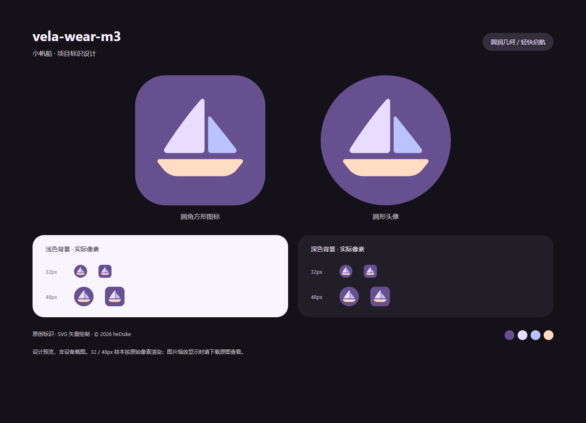

# 小帆船项目标识

原创小帆船标识，以圆润的鼓帆、前帆和弧形船身表现轻快感。船帆与船身沿用组件库现有令牌，背景使用经用户确认提亮的项目品牌色；轮廓是本项目原创设计，不属于官方 Wear M3 组件或小米 Vela 官方标志。

Demo 接入范围、16 包校验与包体增量见 [接入记录](INTEGRATION.md)。

## 文件与使用

- `sailboat.svg`：1024 × 1024 可编辑矢量母版，各部分具有独立 ID，无字体及外部资源依赖。
- `sailboat-{1024,512,192}.png`：满版柔和紫色背景，可交给平台执行裁切。
- `sailboat-circle-{1024,512,192}.png`：圆形裁切，圆外透明，可用于社区头像。
- `sailboat-rounded-{1024,512,192}.png`：圆角方形裁切，圆角半径为边长的 23.4375%，角外透明。
- `preview.png`：1440 × 1040 设计检查图，包含两种裁切，以及深浅背景上的 32 / 48px 实际尺寸样本。并非模拟器或设备截图。

配色：背景 `#67508F`（项目品牌色，非官方组件令牌）、主帆 `#E9DDFF`（primary）、前帆 `#BAC3FF`（secondaryDim）、船身 `#FFDCC2`（tertiary）。

SVG 不绑定圆形或圆角遮罩，便于导出不同用途。船帆与船体间隔 48 个母版像素，在 32px 下保留约 1.5px 空隙；双帆间隔 28 个母版像素。标识整体占画布约 66% 宽，裁切时保留安全留白。

## 重新导出

在仓库根目录安装现有开发依赖后运行 `npm run assets:brand`（或 `node tools/brand-assets.js`）。默认使用系统 Chrome；可用 `CHROME_PATH` 指定浏览器。此命令重建本目录 PNG，不生成 RPK。

Demo 的 `tools/gen.js` 在每次生成时，将本目录 `sailboat-circle-192.png` 作为 `/common/logo.png` 接入 manifest；四布局、两种 API 配置共用同一品牌图标。生成 Demo 不依赖 Chrome。独立组件库保留原通用图标，不包含本目录品牌素材。

## 版权与许可

Copyright © 2026 heDuke。本目录标识与展示图按仓库现有展示素材政策，采用 **PolyForm Noncommercial 1.0.0**；完整条款见 [许可证](../../../licenses/PolyForm-Noncommercial-1.0.0.md)，授权分区见 [LICENSE.md](../../../LICENSE.md)。不授予第三方商标使用权，也不表示官方关联或认证。
